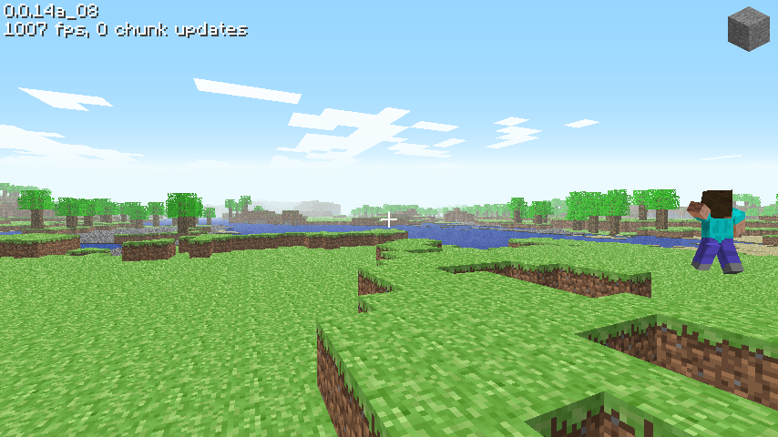

# Classic 0.0.14a_08

[Back to all versions](../README.md)

Released May 28, 2009. The versions between 0.0.13a_03 and this one aren't ported separately,
everything they changed is in here.



## What changed

- New tiles
  - Sand and gravel, they fall when there's air under them
  - Gold, iron and coal ore
  - Log and leaves
- World generation
  - Ore veins in the rock
  - Sand and gravel instead of grass near the water
  - Trees, with a "+" shaped top layer of leaves
  - Two new stages, Growing.. and Planting..
- Every face is shaded by the light of the block in front of it, water and lava included, instead of the old lit and shadow passes
- Clouds
- Generate new level asks for a size: Small, Normal or Huge (128, 256 or 512 wide)
- The daylight fog is linear now, its end is 1024, 256, 64 or 16 blocks depending on the view distance
- Controls
  - **1** to **9** pick one of 9 tiles, the mouse wheel goes through them
  - Middle click picks the block you look at, grass gives dirt
  - Holding the left button keeps breaking or placing, every quarter second
  - **Enter** sets the spawn point to where you stand instead of saving the level
  - **G** only spawns zombies while there are fewer than 256 entities

## How it was ported

- Obfuscated like 0.0.13a_03, ported the same way, on top of it

## Differences from the original

- It's a normal window, not an applet
- Save level.. and Load level.. only did something when you were logged in on minecraft.net, which is gone. Here you're never logged in, so they do nothing, same as the original without an account

## Building and running

### Windows

Install [MSYS2](https://www.msys2.org/), open the **"MSYS2 MinGW x64"** shell (not the plain "MSYS2 MSYS" one) and get the toolchain and libraries:
```bash
pacman -Syu                    # if it asks, close the window and reopen MINGW64, then run again
pacman -S --needed \
  mingw-w64-x86_64-toolchain \
  mingw-w64-x86_64-glfw \
  mingw-w64-x86_64-glew \
  mingw-w64-x86_64-zlib \
  make
```

Build it:
```bash
git clone https://github.com/degradka/mc-classic-c.git
cd mc-classic-c/c0.0.14a_08/src
make
```

Run it from the version's folder, so it finds `resources/`:
```bash
cd ..
./src/minecraft.exe
```

To run it outside the MSYS2 shell, put these next to the exe (they're in `C:\msys64\mingw64\bin`):
- `zlib1.dll`
- `libwinpthread-1.dll`
- `glew32.dll`
- `glfw3.dll`

and the `resources/` folder from the version's folder.

### Linux and macOS
The Makefile has targets for both, but **neither has been tested yet**.

## References

- [minecraft.wiki: Java Edition Classic 0.0.14a_08](https://minecraft.wiki/w/Java_Edition_Classic_0.0.14a_08)
