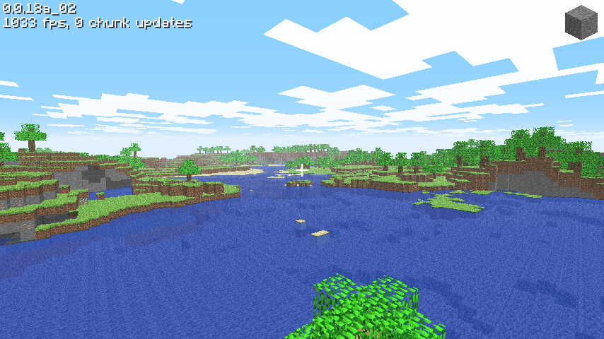

# Classic 0.0.18a_02

[Back to all versions](../README.md)

Released June 14, 2009. 0.0.18a is folded in here.



## What changed

- Chat can send `\`, `@`, `|` and `$` too
- The server can move you around, that's what its new /teleport uses

## How it was ported

- Obfuscated, ported on top of the previous version by diffing the decompiled jars

## Differences from the original

- It's a normal window, not an applet
- The applet got the server from the web page, here it's the command line: `minecraft.exe [host] [port] [username]`
- Save level.. and Load level.. need you to be logged in on minecraft.net, which is gone, so they're always greyed out

## Multiplayer

Pairs with [server 1.4.1](../server/server1.4.1/). Start the server, then from this version's folder:
```bash
./src/minecraft.exe 127.0.0.1 25565 yourname
```
No arguments means singleplayer. Without a name you're `guest`.

## Building and running

### Windows

Install [MSYS2](https://www.msys2.org/), open the **"MSYS2 MinGW x64"** shell (not the plain "MSYS2 MSYS" one) and get the toolchain and libraries:
```bash
pacman -Syu                    # if it asks, close the window and reopen MINGW64, then run again
pacman -S --needed \
  mingw-w64-x86_64-toolchain \
  mingw-w64-x86_64-glfw \
  mingw-w64-x86_64-glew \
  mingw-w64-x86_64-zlib \
  make
```

Build it:
```bash
git clone https://github.com/degradka/mc-classic-c.git
cd mc-classic-c/c0.0.18a_02/src
make
```

Run it from the version's folder, so it finds `resources/`:
```bash
cd ..
./src/minecraft.exe
```

To run it outside the MSYS2 shell, put these next to the exe (they're in `C:\msys64\mingw64\bin`):
- `zlib1.dll`
- `libwinpthread-1.dll`
- `glew32.dll`
- `glfw3.dll`

and the `resources/` folder from the version's folder.

### Linux and macOS
The Makefile has targets for both, but **neither has been tested yet**.

## References

- [minecraft.wiki: Java Edition Classic 0.0.18a_02](https://minecraft.wiki/w/Java_Edition_Classic_0.0.18a_02)
- [minecraft.wiki: Java Edition Classic 0.0.18a](https://minecraft.wiki/w/Java_Edition_Classic_0.0.18a)
