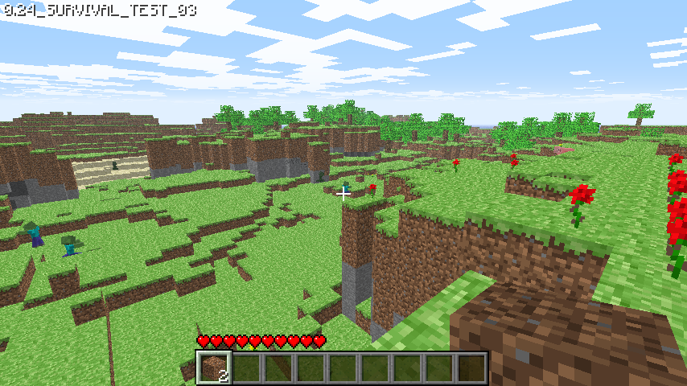

# Classic 0.24_SURVIVAL_TEST_03

[Back to all versions](../README.md)

Released September 1, 2009. The start of Survival Test.
0.24_SURVIVAL_TEST to 0.24_SURVIVAL_TEST_02 are folded in here.



## What changed

- Health
  - 10 hearts, fall damage, drowning with air bubbles, lava
  - Getting hit flashes, knocks you back and wobbles the camera
  - A Game over screen with your score, the only way out is Generate new level
- Mobs
  - Zombie, skeleton, creeper and pig, each with its own health
  - They wander, chase you and attack, and tip over when they die
  - Left click hits whatever you aim at
  - New levels get mobs right away
- Items
  - Broken tiles drop items you walk over to pick up
  - The inventory starts empty, up to 99 per slot, placing uses one
  - Killing mobs gives score
- **Tab** shoots an arrow
- **B** throws a sign
- Breaking takes time now, with cracks on the block

## How it was ported

- Ported with names: the RetroMCP names for 0.0.23a_01 carried to this jar with a matcher that pairs classes and methods by their structure, the rest named by hand
- Afterwards the whole C code was checked against the whole jar, not just the diff, and the bugs it found were fixed

## Differences from the original

- It's a normal window, not an applet
- No multiplayer. The original jar still has its connection code (the applet could get a server), it's left out here
- Fully offline: no skin downloads, always `char.png`, and Save level.. and Load level.. stay greyed out, they need a minecraft.net login that's gone
- The original can't save at all (part of its level isn't serializable), so every restart made a new level.
  Here `level.dat` is saved in the older version 1 format, which the original reads, so the world stays
- At most 64 arrows and 256 dropped items exist at once, java has no limit
- Singleplayer only, like the original

## Building and running

### Windows

Install [MSYS2](https://www.msys2.org/), open the **"MSYS2 MinGW x64"** shell (not the plain "MSYS2 MSYS" one) and get the toolchain and libraries:
```bash
pacman -Syu                    # if it asks, close the window and reopen MINGW64, then run again
pacman -S --needed \
  mingw-w64-x86_64-toolchain \
  mingw-w64-x86_64-glfw \
  mingw-w64-x86_64-glew \
  mingw-w64-x86_64-zlib \
  make
```

Build it:
```bash
git clone https://github.com/degradka/mc-classic-c.git
cd mc-classic-c/c0.24_st_03/src
make
```

Run it from the version's folder, so it finds `resources/`:
```bash
cd ..
./src/minecraft.exe
```

To run it outside the MSYS2 shell, put these next to the exe (they're in `C:\msys64\mingw64\bin`):
- `zlib1.dll`
- `libwinpthread-1.dll`
- `glew32.dll`
- `glfw3.dll`

and the `resources/` folder from the version's folder.

### Linux and macOS
The Makefile has targets for both, but **neither has been tested yet**.

## References

- [minecraft.wiki: Java Edition Classic 0.24_SURVIVAL_TEST_03](https://minecraft.wiki/w/Java_Edition_Classic_0.24_SURVIVAL_TEST_03)
- [minecraft.wiki: Java Edition Classic 0.24 SURVIVAL TEST](https://minecraft.wiki/w/Java_Edition_Classic_0.24_SURVIVAL_TEST)
- [minecraft.wiki: Java Edition Classic 0.24 SURVIVAL TEST 01](https://minecraft.wiki/w/Java_Edition_Classic_0.24_SURVIVAL_TEST_01)
- [minecraft.wiki: Java Edition Classic 0.24 SURVIVAL TEST 02](https://minecraft.wiki/w/Java_Edition_Classic_0.24_SURVIVAL_TEST_02)
