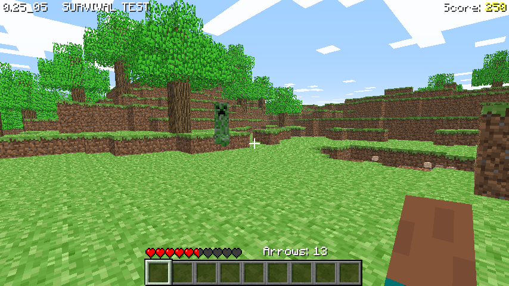

# Classic 0.25_05 SURVIVAL TEST

[Back to all versions](../README.md)

Released September 3, 2009. 0.25 SURVIVAL TEST to 0.25 SURVIVAL TEST 4 are folded in here.



## What changed

- Mobs
  - They see you from 16 blocks away instead of 8 and run straight at you, zombies at full speed, creepers a bit
    slower, skeletons slowly. Pigs, creepers and skeletons also wander slower than before
  - They keep chasing once they have you, and only give up far away
  - They turn on whoever hurts them, so they fight each other, but never their own kind
  - They respawn during play, at least 16 blocks from you, and idle ones far away despawn
  - Their hits do 1-6 (zombies, creepers) or 1-8 (skeletons) instead of 1-7
  - Skeletons shoot arrows and drop a few arrows you can pick up when they die
  - A creeper hurts itself only when its hit lands, 6 instead of 4
  - Pigs drop 1-2 brown mushrooms
- Arrows
  - You start with 20, up to 99, every shot uses one
  - Yours do 7 damage, a mob's 3, and stuck ones can be picked back up
  - You can hit yourself with your own arrows
- Only the left mouse button hits mobs
- A dead player doesn't pick up items any more
- The score is in the top right corner, the arrow count above the hotbar
- The Game over screen has a Load level.. button
- Leaves drop a sapling 1 in 10 times instead of 1 in 6

## How it was ported

- Ported with names: the RetroMCP names for 0.0.23a_01 carried to this jar with a matcher that pairs classes and methods by their structure, the rest named by hand
- Afterwards the whole C code was checked against the whole jar, not just the diff, and the bugs it found were fixed

## Differences from the original

- It's a normal window, not an applet
- No multiplayer. The original jar still has its connection code (the applet could get a server), it's left out here
- Fully offline: no skin downloads, always `char.png`, and Save level.. and Load level.. stay greyed out, they need a minecraft.net login that's gone
- At most 64 arrows and 256 dropped items exist at once, java has no limit
- Singleplayer only, like the original

## Building and running

### Windows

Install [MSYS2](https://www.msys2.org/), open the **"MSYS2 MinGW x64"** shell (not the plain "MSYS2 MSYS" one) and get the toolchain and libraries:
```bash
pacman -Syu                    # if it asks, close the window and reopen MINGW64, then run again
pacman -S --needed \
  mingw-w64-x86_64-toolchain \
  mingw-w64-x86_64-glfw \
  mingw-w64-x86_64-glew \
  mingw-w64-x86_64-zlib \
  make
```

Build it:
```bash
git clone https://github.com/degradka/mc-classic-c.git
cd mc-classic-c/c0.25_05_st/src
make
```

Run it from the version's folder, so it finds `resources/`:
```bash
cd ..
./src/minecraft.exe
```

To run it outside the MSYS2 shell, put these next to the exe (they're in `C:\msys64\mingw64\bin`):
- `zlib1.dll`
- `libwinpthread-1.dll`
- `glew32.dll`
- `glfw3.dll`

and the `resources/` folder from the version's folder.

### Linux and macOS
The Makefile has targets for both, but **neither has been tested yet**.

## References

- [minecraft.wiki: Java Edition Classic 0.25_05 SURVIVAL TEST](https://minecraft.wiki/w/Java_Edition_Classic_0.25_05_SURVIVAL_TEST)
- [minecraft.wiki: Java Edition Classic 0.25 SURVIVAL TEST](https://minecraft.wiki/w/Java_Edition_Classic_0.25_SURVIVAL_TEST)
- [minecraft.wiki: Java Edition Classic 0.25 SURVIVAL TEST 2](https://minecraft.wiki/w/Java_Edition_Classic_0.25_SURVIVAL_TEST_2)
- [minecraft.wiki: Java Edition Classic 0.25 SURVIVAL TEST 3](https://minecraft.wiki/w/Java_Edition_Classic_0.25_SURVIVAL_TEST_3)
- [minecraft.wiki: Java Edition Classic 0.25 SURVIVAL TEST 4](https://minecraft.wiki/w/Java_Edition_Classic_0.25_SURVIVAL_TEST_4)
