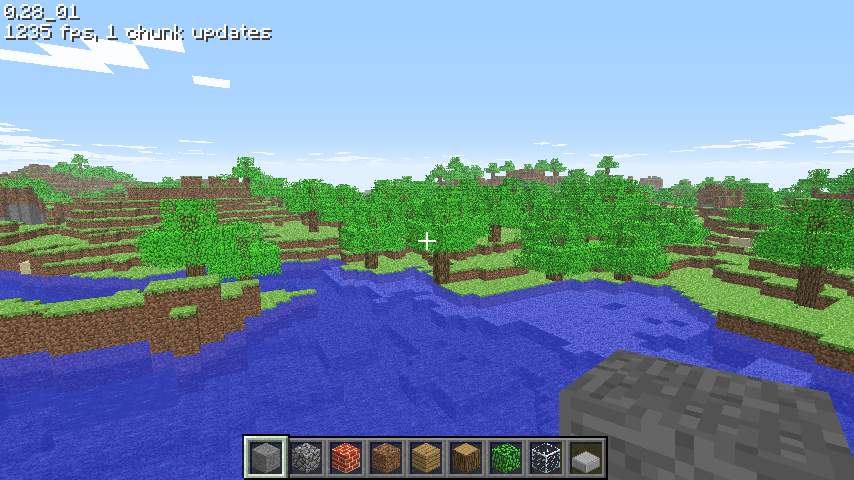

# Classic 0.28_01

[Back to all versions](../README.md)

Released October 27, 2009, the same day as 0.28, which is folded in here.
Survival Test is over: it's creative building again, and multiplayer is back.



## What changed

- Creative
  - Blocks break right away, placing uses nothing up, nothing takes damage, reach is 5 again
  - Hearts, air, score and the arrow count are hidden
  - The survival code is still in the jar, but it always starts in creative
- **B** opens the block select screen with every placeable tile, obsidian included
- Middle click picks the block you look at into the hotbar
- **Enter** sets the spawn point, **R** takes you back to it
- TNT doesn't explode anymore, it just breaks
- Sheep, they eat grass and regrow their wool. They only spawn in survival, so you won't see them normally
- Multiplayer is back
  - Other players are full humanoid mobs with name tags, they push you a little when you walk into them
  - **Tab** shows who's connected
- Menus have their gradient back, water and lava sides use the whole texture
- Chunks are drawn in two layers, sorted the way java does it

## How it was ported

- Ported with names: the RetroMCP names for 0.0.23a_01 carried to this jar with a matcher that pairs classes and methods by their structure, the rest named by hand
- Afterwards the whole C code was checked against the whole jar, not just the diff, and the bugs it found were fixed

## Differences from the original

- It's a normal window, not an applet
- Fully offline: no skin downloads, always `char.png`, and Save level.. and Load level.. stay greyed out, they need a minecraft.net login that's gone
- At most 64 arrows and 256 dropped items exist at once, java has no limit
- The applet got the server from the web page, here it's the command line: `minecraft.exe [host] [port] [username]`

## Multiplayer

Start [server 1.9](../server/server1.9/), then from this version's folder:
```bash
./src/minecraft.exe 127.0.0.1 25565 yourname
```
No arguments means singleplayer.

## Building and running

### Windows

Install [MSYS2](https://www.msys2.org/), open the **"MSYS2 MinGW x64"** shell (not the plain "MSYS2 MSYS" one) and get the toolchain and libraries:
```bash
pacman -Syu                    # if it asks, close the window and reopen MINGW64, then run again
pacman -S --needed \
  mingw-w64-x86_64-toolchain \
  mingw-w64-x86_64-glfw \
  mingw-w64-x86_64-glew \
  mingw-w64-x86_64-zlib \
  make
```

Build it:
```bash
git clone https://github.com/degradka/mc-classic-c.git
cd mc-classic-c/c0.28_01/src
make
```

Run it from the version's folder, so it finds `resources/`:
```bash
cd ..
./src/minecraft.exe
```

To run it outside the MSYS2 shell, put these next to the exe (they're in `C:\msys64\mingw64\bin`):
- `zlib1.dll`
- `libwinpthread-1.dll`
- `glew32.dll`
- `glfw3.dll`

and the `resources/` folder from the version's folder.

### Linux and macOS
The Makefile has targets for both, but **neither has been tested yet**.

## References

- [minecraft.wiki: Java Edition Classic 0.28_01](https://minecraft.wiki/w/Java_Edition_Classic_0.28_01)
- [minecraft.wiki: Java Edition Classic 0.28](https://minecraft.wiki/w/Java_Edition_Classic_0.28)
